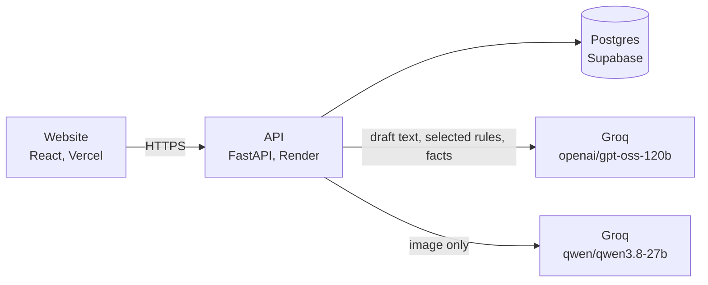

# BrandGuard AI

A review desk that sits between a finished draft and the publish button. A creator pastes or uploads
content, with its images; BrandGuard checks it against the brand's approved rules, facts, terminology,
colours and logo; every issue comes back with the exact passage, the rule or fact it breaks, a plain
reason and a suggested fix. People make every approval decision.

**Team Nova Blasters** · CodeNova India 2026 · Round 3 build (19 to 21 November 2026)

- **Live app:** https://brandguard-ai-lac.vercel.app
- **API:** https://brandguard-api-qtj3.onrender.com/api/health
- **What changed in Round 3:** [CHANGELOG.md](CHANGELOG.md) · **How it is tested:** [docs/TESTING.md](docs/TESTING.md) · **What comes next:** [ROADMAP.md](ROADMAP.md)

During judging a scheduled GitHub Action keeps the free server awake day and night. If it was asleep
anyway, the app shows "Waking the server…" and finishes the request by itself within a minute.

## Try it in two minutes

There are two fictional demo brands with opposite styles. All their rules, facts, images and content
are made up.

- **Lumio Payroll** (payroll software): calm, careful copy. No hype, no pressure, no shouting, one
  exclamation mark at most, every number backed by an approved fact.
- **Fizzbox** (soft drinks): loud and playful. "Grab yours NOW!" and "BUY NOW" are on-brand, but health
  claims, anything aimed at children and wrong sugar or calorie numbers are high-risk.

On the sign-in page choose **Try the demo**, pick a brand and a person. You get your own private copy
(15 drafts for Lumio, 12 for Fizzbox, at every stage of review), and a short tour for your role. Switch
person with **Act as**, jump to the other brand with **Compare with…**, and **Start over** for a fresh
copy. Press **Ctrl+K** to jump anywhere.

| Person | Role | What to try |
|---|---|---|
| Asha / Kabir | Creator | Open the draft at the top: it has text and an image with problems planted in both. Accept all low-risk fixes, describe the image, dispute a finding, then **Send for review**. |
| Rohan / Tara | Manager | Open a draft waiting for you. With a high-risk finding open, **Hold to approve and escalate** sends it to the brand owner. |
| Meera / Neel | Brand owner | Waive a high-risk finding with a reason, then approve. In **Brand health**, scroll to **Guideline gaps** and ask for a clearer wording of the rule people keep arguing with. Edit colours and the logo in **Brand Library**. |

Anyone can open **Reliability** to see how often the check catches what it should.

**Or create your own brand:** on the sign-in page choose **Create a brand**. You become its brand owner,
its library starts with sample rules you can change, and on **Team** you add teammates.

## What it does

**Review**
- Content by pasting, by uploading `.txt`, `.md`, `.docx` or `.pdf`, or from any web page with the
  **Check with BrandGuard** bookmarklet (on the Account page). Up to four images per draft.
- **Checks while typing** (exact checks only, nothing stored or sent to AI), including channel limits.
- **Exact checks in code**, the same answer every time: banned terms, rule patterns, numbers next to a
  fact's keywords against the approved value, expired facts, and channel limits (Instagram 2,200
  characters and 30 hashtags, LinkedIn 3,000 characters, ad text over 125).
- **AI checks** for tone, positioning, competitors and unsupported claims. **No citation, no finding:**
  an AI finding is kept only if its quote is in the draft and its rule exists; the rest are dropped and
  counted.
- **Image review:** the image's colours against the brand palette, the contrast of each line of text in
  it (WCAG 2.2 AA), the logo's proportions and colour against the official file, the text inside it
  (checked like the draft's own text), and its description for screen readers. The vision model only
  reads the image; every judgement is measured in code. The draft page draws what was measured on the
  image.
- Each finding: the quote, the cited rule or fact, the reason, the severity, a suggested fix. Accept it,
  write your own, or dispute it. **Accept all low-risk fixes** does the terminology in one go. Hover a
  fix to see the sentence as it would read; a fix can be undone. Findings show how the same rule was
  handled on earlier drafts (precedents). Keys: J / K move between findings, A accepts, D disputes.
- **Channel previews:** how the draft looks as a LinkedIn post, an Instagram caption or an email, with
  the point where "…see more" cuts it.
- **Make this a rule** (brand owner): select text in a draft and get a rule drafted from it; the exact
  pattern is built in code, the AI only words it.
- **Check many posts:** paste a content calendar or upload a CSV and get a verdict for every post from
  the exact checks; any post becomes a draft for the full check.
- "How this was checked" on every review: what came from code and from AI, the provider and models,
  what was sent, how many AI findings were dropped.

**Workflow and record**
- Draft → In review → Changes requested / Authorised review → Approved. Nobody approves their own
  draft. A manager's approval with high-risk findings open goes to the brand owner, who waives each with
  a written reason, decides the dispute, or sends it back. Approving and waiving are press-and-hold with
  a few seconds to undo.
- Comments, every version (compare any two word by word), an append-only history, due dates.
- Pages update by themselves when a teammate acts in another window (the draft list re-sorts smoothly,
  the waiting badge updates, the draft page says who did what).
- **Review record:** a printable page with the approved text, who approved it, every finding and how it
  was handled, and the full timeline. Share it read-only by link for 30 days, no account needed.

**Brand Library** (the brand owner edits; everyone reads)
- Rules (with optional exact patterns), approved facts with sources and end dates, terms, brand colours
  and the logo. Import rules from guideline text, a PDF or Word file, or a spreadsheet (CSV); imported
  rules wait for approval. Download the rules as a spreadsheet. Every rule keeps its earlier wordings.

**Brand health and guideline gaps**
- Most broken rules, findings per channel, risk split, what happened to each finding, time to approval.
- **Guideline gaps:** rules whose findings are often waived, dismissed or disputed rather than fixed,
  with the real cases. The owner asks for a clearer wording, compares it, edits and accepts it; numbers
  are then shown before and after the change. **Look for missing rules** reads review notes and proposes
  rules no current rule covers.
- **Re-check alerts:** approved content that quotes a fact that has since expired or changed.

**Reliability page**
- The score of the check on 80 test drafts with planted problems (40 per brand, 10 of them clean), for
  exact checks and for the full check with AI: what it catches, how much of what it flags is real, the
  trend over runs, per rule, and every miss and false alarm. **Run the test now** runs the exact checks
  on all 80 cases live in front of you.

**Teams and access**
- Each brand is a private workspace: every API route checks the person's brand. Owners add teammates,
  change roles, remove and re-add people. Every demo visitor gets a private copy of a demo brand.

**When things go wrong**
- Acting on an out-of-date page (someone else acted first) is refused with who did what, and the page
  refreshes. Double clicks do not double up. Long input, renamed or broken files get clear messages. A
  sleeping server, no connection, a failed AI call or a crashed screen each get a plain notice and a way
  forward. A draft being written survives a refresh.

## Latest scores

From [docs/TESTING.md](docs/TESTING.md), where every number is explained:

| | Lumio Payroll | Fizzbox |
|---|---|---|
| Exact checks (every push): planted problems caught | 27 of 27 | 29 of 29 |
| Full check with AI, last two runs: planted problems caught | 34 and 33 of 35 (97.1%, 94.3%) | 37 of 37 both times |
| Full check with AI, last two runs: of what it flagged, real | 87.2%, 78.6% | 94.9%, 92.5% |
| Browser journeys passing | 5 of 5, with an accessibility scan of 9 screens, plus dark mode | |
| Load test, live server | 15 people at once, 105 requests, 0 failed | |

## How it works



One review run (`backend/app/engine/run.py`):

1. **Exact checks** on the text (`engine/exact.py`).
2. **AI checks:** the model gets the draft, its purpose, the relevant rules without patterns, the facts,
   what the exact checks already found, and the rules its own fixes must obey (`engine/ai.py`).
3. **Verification** drops any AI finding whose quote is not in the draft or whose rule does not exist
   (`engine/verify.py`). AI-written fixes are cleaned against the terms and patterns.
4. **Images** (`engine/image.py`): colours, contrast and logo are measured on the pixels; the vision
   model reads the text, finds the logo and suggests a description; the text goes back through steps 1 to 3.
5. Findings and a disclosure record are saved. The AI never approves, waives or publishes. Without an
   AI key, or if the AI fails, the exact checks and image measurements still run and the review says so.

## Run it locally

You need Python 3.12 or newer and Node 20 or newer. One command installs what is missing and starts
both the API and the website:

```bash
sh scripts/dev.sh
```

On Windows:

```bash
powershell -ExecutionPolicy Bypass -File scripts/dev.ps1
```

Then open http://localhost:5173 and choose **Try the demo**. It uses a local SQLite database; the
first run builds both demo brands and their drafts in it (exact checks only, about half a minute). For the AI checks, put `GROQ_API_KEY=...` in `backend/.env`
(a free key from console.groq.com); the script reads only that line.

**By hand:** in `backend`, create a virtual environment, `pip install -r requirements.txt`, then
`uvicorn app.main:app --port 8000`. In `frontend`, `npm ci` then `npm run dev` (it forwards `/api` to
port 8000).

**Tests:** `cd backend && python -m pytest` (70 tests, including the reliability gate) ·
`cd frontend && npm run e2e` (browser journeys; first time `npx playwright install chromium`) ·
`cd backend && python -m evals.run` (the reliability score; `--mode ai` with a key).

## Deploy

| Service | Settings |
|---|---|
| Supabase | New project. Turn the Data API off and automatic RLS on (the backend connects directly). Copy the **Session pooler** connection string. |
| Render | Web service, root `backend`, build `pip install -r requirements.txt`, start `uvicorn app.main:app --host 0.0.0.0 --port $PORT`, health check `/api/health`. Variables: see `backend/.env.example`. |
| Vercel | Import the repo with root `frontend` (Vite). Variable `VITE_API_URL` = the Render address. Redeploy after changing it. |

## Resetting the demo

Visitors work in private copies, so the demo brands themselves never change (only this script may
change them). To rebuild what visitors start from, run this in `backend` with the live database address
in `backend/.env` (`DATABASE_URL`; add `GROQ_API_KEY` to include AI findings):

```bash
python -m app.reset_demo --env-file .env
```

It shows which database it will change and asks you to type `reset`. Visitors' copies are cleared;
brands people created are kept. `backend/.env` is ignored by git; never commit it.

## Known limits

- The exact checks are scored on every push. The full check with AI runs nightly in CI
  (`reliability-ai.yml`) only once a `GROQ_API_KEY` repository secret is added; until then it is skipped
  and run by hand, with results committed.
- Logo checks compare shape and main colour. They do not catch a logo redrawn in a different font.
- Contrast is measured per line of text; text on a busy photo can be measured on the wrong background.
- Rules, terms and the AI prompts are in English. Hindi and other Indian scripts are checked for terms,
  patterns and numbers, but there are no Hindi rules in the demo brands.
- Video and audio are not reviewed.
- No email notifications yet: the menu shows how many drafts wait for you.
- The free server and AI plan limit how many checks can run at once; under heavy use the app asks you
  to wait a minute rather than failing silently.
- Dark mode is opt-in (Account page, or the header menu); the default is the light theme.

## Repository layout

```
backend/
  app/
    main.py, config.py, auth.py, limits.py   app, settings, sign-in, rate limits
    models.py, migrate.py                    tables, and in-place upgrades on start
    seed.py, samples.py, sandbox.py          demo brands, their images, private demo copies
    reset_demo.py                            rebuilds the demo drafts
    engine/   exact.py, ai.py, verify.py, image.py, run.py, extract.py
    routers/  accounts (teams, demo), library (rules, facts, terms, colours, logo),
              drafts (review, workflow, images, sharing), insights (Brand health, guideline gaps),
              reliability
  evals/      cases/ (80 test drafts), run.py (the scorer), load.py, results/
  tests/      70 tests
frontend/
  src/pages/  Login, Drafts, NewDraft, DraftView, Bulk, Record, Insights, Library, Reliability, Team, Account
  src/        ImagePanel, ChannelPreview, MakeRule, LiveRun, CompareBrands, GuidelineGaps, LiveText,
              Tour, CommandMenu, Resilience, poll, theme, ui, api
  e2e/        browser tests
scripts/      dev.sh, dev.ps1: one-command local setup
docs/         TESTING.md, the Round 2 deck
```

## Disclosure

- **External services:** Groq (AI checks and image reading), Supabase (database), Render and Vercel
  (hosting), Google Fonts (Bricolage Grotesque, Public Sans, Caveat).
- **What the AI receives:** the draft text, its channel, audience and purpose, the selected rules, the
  approved facts and the terms; for images, the image and the brand's logo. No names or email addresses.
- **AI tools used to build it:** the team used Claude Code (Anthropic) as a coding assistant for
  planning, code, tests and documentation. Every change was reviewed and tested by the team.
- **Demo data:** Lumio Payroll and Fizzbox, their rules, facts, people, posts, images and logos are
  fictional, drawn in code.
- Open-source libraries are listed in `backend/requirements.txt` and `frontend/package.json`.

## Team

| Member | Role |
|---|---|
| Tanmoy Ghosh | Team leader, UI/UX design |
| Deepanjan Mandal | Frontend |
| Sohom Koley | Frontend |
| Auritras Maitra | Backend |
| Sounavo Majumder | ML (review engine) |
| Deepanjan Panda | Research and analysis |
